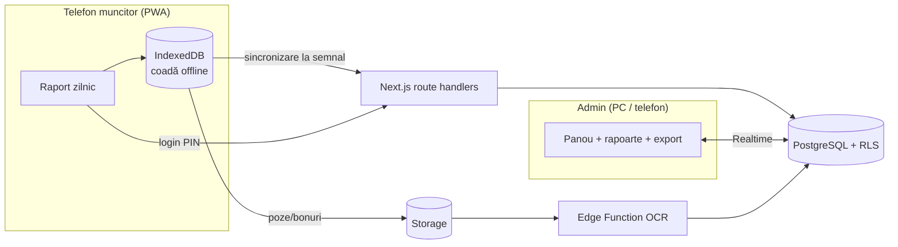

# Șantier — aplicație de management pentru amenajări interioare

PWA cloud-first: muncitorii raportează de pe telefon (inclusiv fără semnal), administratorul vede totul în timp real de pe PC sau telefon.

## 1. Stiva aleasă și de ce

| Strat | Tehnologie | Motiv |
|---|---|---|
| Frontend | **Next.js 15 (App Router) + React 19 + Tailwind 4** | Un singur cod pentru mobil și desktop, Server Components pentru panoul de admin, route handlers pentru logica sensibilă |
| PWA / offline | **Serwist** (service worker) + **IndexedDB** (`idb-keyval`) | Aplicația se deschide fără semnal; rapoartele se salvează local și se trimit automat |
| Backend | **Supabase**: PostgreSQL, Auth, Storage, Realtime, Edge Functions | Postgres real (rapoarte SQL, view-uri de profitabilitate), securitate la nivel de rând (RLS), timp real inclus, fără server propriu de întreținut |
| OCR | Edge Function → model AI cu viziune (ex. Claude) sau Google Document AI | Extrage furnizor, CUI, dată, total, TVA și liniile bonului în JSON; omul doar confirmă |
| Export | **ExcelJS** (XLSX) + CSV cu `;` și BOM | Se deschide corect în Excel cu setări românești |
| Hosting | Vercel (frontend) + Supabase Cloud, regiunea **eu-central-1 (Frankfurt)** | Date în UE (GDPR), cost zero/mic la început |

De ce nu Firebase: datele sunt relaționale (oferte → articole → materiale → consumuri → costuri), iar contabilitatea primară cere agregări SQL. Postgres + RLS face asta nativ.

## 2. Arhitectura



**Principii de securitate**
- Toate tabelele au RLS. Un muncitor vede doar șantierele la care e alocat, doar rapoartele lui și catalogul **fără prețuri** (view-uri `v_worker_*`). Coloana `labor_cost` e ascunsă la nivel de coloană.
- PIN-ul (bcrypt) stă în `worker_secrets`, tabel fără nicio politică RLS → accesibil doar serverului. Blocare 15 min după 5 încercări greșite.
- Login cu PIN doar pe **dispozitive activate de admin** (cookie httpOnly valabil 1 an, revocabil). Fără asta, oricine de pe internet ar vedea lista de nume și ar putea ghici PIN-uri de 4 cifre.
- Adminul intră cu email + parolă; activează MFA (TOTP) din Supabase Auth.
- Prețurile din ofertă și costul manoperei se salvează ca **snapshot** la momentul respectiv, ca modificările ulterioare de catalog să nu rescrie istoria.

## 3. Baza de date (`supabase/migrations/0001_schema.sql`)

| Zonă | Tabele |
|---|---|
| Utilizatori și roluri | `profiles` (rol `admin`/`worker`, meserie), `trades`, `worker_secrets` (PIN), `worker_rates` (tarif pe oră / zi / acord), `trusted_devices` |
| Șantiere | `clients`, `sites`, `site_assignments` |
| Catalog | `materials` (preț, % pierderi), `work_items` (preț manoperă, normă ore, bază de calcul), `work_item_materials` (consum normat / unitate) |
| Ofertare / deviz | `quotes`, `quote_rooms` (suprafețe calculate automat: pardoseală, pereți minus goluri, perimetru), `quote_items` |
| Necesar materiale | `material_requirements` (din deviz via `generate_requirements_from_quote()` sau manual de pe șantier) |
| Raport zilnic | `daily_reports`, `report_progress`, `material_consumptions`, `report_photos` |
| Cheltuieli | `expenses` (bon/factură, OCR brut, stare validare), `expense_lines` |
| Contabilitate primară | view-uri `v_site_labor`, `v_site_profitability` |

**Cum funcționează estimarea:** fiecare `work_item` are o bază de calcul (ex. „Gletuire pereți” → `suprafata_pereti`). Când adaugi o încăpere de 4 × 3 × 2,6 m cu 3 mp goluri, aplicația calculează automat 33,4 mp pereți, propune cantitatea, iar `work_item_materials` dă necesarul (ex. 1,2 kg glet/mp + 10% pierderi).

## 4. Structura proiectului

```
santier-app/
├─ app/
│  ├─ login/page.tsx                 # selectare persoană + tastatură PIN
│  ├─ teren/                         # interfața muncitorului (doar rol worker)
│  │  ├─ layout.tsx                  # gardă de rol
│  │  └─ raport/page.tsx             # raport zilnic, offline-first
│  ├─ admin/
│  │  ├─ login/page.tsx              # email + parolă
│  │  └─ (panou)/                    # gardă de rol admin
│  │     ├─ layout.tsx               # navigație
│  │     ├─ page.tsx                 # situație + profitabilitate
│  │     ├─ live-feed.tsx            # Realtime
│  │     ├─ santiere/ oferte/ cheltuieli/ rapoarte/ catalog/ echipa/   (de construit)
│  └─ api/
│     ├─ auth/pin | workers | device | logout
│     └─ export/site/[id]            # XLSX / CSV
├─ lib/
│  ├─ supabase/server.ts, client.ts
│  ├─ offline-queue.ts               # IndexedDB + sincronizare idempotentă
│  └─ device.ts                      # dispozitive de încredere
├─ supabase/
│  ├─ migrations/0001_schema.sql
│  └─ functions/ocr-receipt/         # (de construit) Edge Function OCR
├─ public/manifest.webmanifest
└─ middleware.ts
```

## 5. Pași de implementare

1. `npx create-next-app@latest santier-app --ts --tailwind --app`, apoi copiază fișierele de aici și `npm i`.
2. Creează proiectul în Supabase (regiunea Frankfurt). Copiază cheile în `.env.local` (vezi `.env.example`).
3. Rulează migrarea: `npx supabase db push` sau lipește SQL-ul în SQL Editor.
4. Creează primul admin: în Dashboard → Authentication → Add user, apoi `insert into profiles (id, full_name, role) values ('<uuid>', 'Nume', 'admin');`
5. Pentru fiecare muncitor: creează un user cu email intern (`ion.pop@echipa.local`, fără confirmare), un rând în `profiles` cu `role='worker'` și `trade_id`, apoi din panou `select set_worker_pin('<uuid>', '4821');` și alocă-l pe șantier în `site_assignments`.
6. Pe tableta/telefonul de șantier: intră ca admin, apasă „Activează dispozitivul” (apelează `POST /api/auth/device`), ieși. De acum ecranul de login arată echipa.
7. Adaugă Serwist (`@serwist/next`) pentru precache și pagina offline; generează iconițele 192/512.
8. Generează tipurile TypeScript: `npm run db:types`.

## 6. OCR bonuri și facturi (următorul modul)

Flux: poză (compresie ~400 KB) → `receipts/{user_id}/…` → Edge Function `ocr-receipt` → model cu viziune care întoarce JSON strict `{furnizor, cui, nr_doc, data, net, tva, total, linii[]}` → se scrie în `expenses` cu `status='de_verificat'` și `ocr_confidence`. Adminul vede poza lângă câmpurile precompletate, corectează și apasă **Validează**. Doar cheltuielile validate intră în profitabilitate. Liniile pot fi legate de `materials` pentru a compara consumul real cu necesarul din deviz.

Pentru facturile primite prin **RO e-Factura** (SPV) se poate citi direct XML-ul UBL, fără OCR — mult mai precis.

## 7. Ghid UX/UI pentru șantier

- **Ținte mari:** minim 56 px înălțime pentru orice buton, 64–80 px pentru acțiuni principale și tastatura PIN. Spațiu de minim 12 px între ținte (mănuși, degete murdare).
- **Contrast pentru soare:** text grafit `#1C1F1D` pe fundal deschis, acțiunea principală ultramarin `#2340C8` (7,9:1 cu alb). Fără gri deschis pentru text. Font **Atkinson Hyperlegible**, minim 18 px.
- **Fără tastatură unde se poate:** ore cu stepper ±0,5 și scurtături 4/8/10; șantierul se alege prin atingere; preselectare dacă e unul singur; PIN cu trimitere automată la ultima cifră.
- **Acțiunea principală jos, fixă**, în zona degetului mare; textul spune exact ce face („Trimite raportul”, nu „OK”).
- **Starea conexiunii mereu vizibilă** (Online / Offline / N în așteptare). Nimic nu se pierde: raportul se salvează întâi local.
- **Confirmare clară:** ecran întreg cu bifă verde (trimis) sau ceas ocru (salvat, se trimite automat) + vibrație scurtă.
- **Un ecran = o sarcină.** Muncitorul vede doar raportul lui; meniurile complexe sunt doar la admin.
- **Erorile spun ce s-a întâmplat și ce faci** („Prea multe încercări. Contul e blocat 15 minute.”), fără coduri tehnice.
- Admin pe desktop: tabele dense, cifre aliniate (`tabular-nums`), filtre, export dintr-un clic. Pe mobil, tabelele se derulează orizontal.

## 8. Roadmap

1. **Faza 1 (MVP, 3–4 săpt.):** login PIN, raport zilnic offline, admin: șantiere, echipă, catalog, profitabilitate, export.
2. **Faza 2:** ofertare cu încăperi + generare PDF ofertă pentru client, necesar materiale din deviz, încărcare bonuri cu OCR.
3. **Faza 3:** plată în acord (cantități × tarif), aprobare rapoarte, notificări push, integrare e-Factura / export pentru contabil (SAGA, WinMentor).
